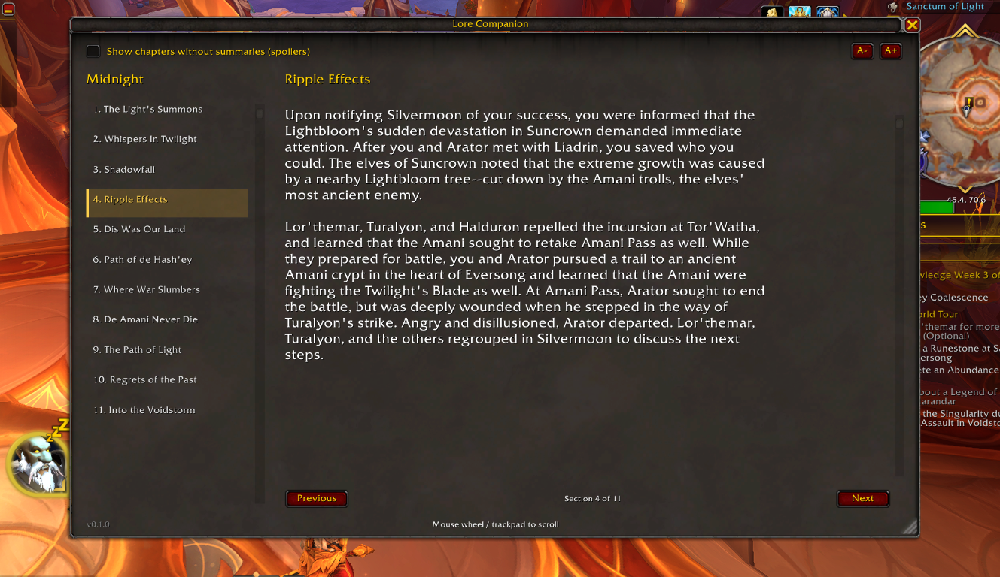
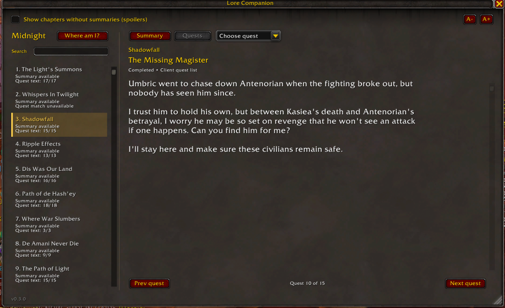

# Lore Companion 0.2.3

A World of Warcraft Retail addon for reading original campaign summaries and
bundled quest descriptions. Open it with `/lore`.

Use `/lore scan` in WoW to show campaign chapter metadata and candidate quest IDs
in a scrollable copy window. Text is selected automatically: press Cmd+C on Mac
or Ctrl+C on Windows, then paste the results outside WoW. Use **Select all** to
select the text again. This reveals chapter names (spoilers). The scan tests each chapter ID as
a questline ID; results do not establish membership, completeness, or story order.
It does not update the bundled quest mapping.

- **Summary:** Blizzard's campaign recap.
- **Quest data:** builds request 233 candidate quests across the 17 scanned Midnight
  campaign chapters. Expansion-wide completeness and narrative order remain unverified.
- **Quests view:** displays bundled quests when the selected heading uniquely
  matches a bundled chapter title. Missing or ambiguous matches show an unavailable
  message. Read one quest at a time using **Prev quest**
  and **Next quest**, with a quest counter and a separate title. Choose chapters
  from the left list. Full dialogue is not included; hover over the Quests tab
  for the source and ordering note.
- **Quest navigation:** the chapter name stays above the quest title. Use
  **Choose quest** to jump directly to a quest; missing descriptions are labelled
  in the menu. Longer menus scroll.
- **Reading bookmarks:** reopening `/lore` restores the last chapter, tab, and
  quest per character. Quests are remembered by ID, so a reordered list can still
  restore the same quest. A removed quest falls back to the first quest. Chapters
  revealed only through the spoiler checkbox are not saved; spoiler consent is
  reset when the window closes. Scroll position is not saved between openings.
- **Text availability:** chapter rows show summary availability and the number of
  bundled descriptions, for example **Quest text: 16/17**. These are text counts,
  not completion indicators. Unmatched headings, ambiguous matches, missing data,
  and missing individual descriptions have separate explanations. Title matching
  still requires the bundled English heading.




## Build and deploy

Install [uv](https://docs.astral.sh/uv/getting-started/installation/). Create
`tools/quest-data-fetcher/.env` from its `.env.example` and fill in your Blizzard
API client credentials. Keep an existing `.env` if already configured.

```sh
uv run manage.py --build
uv run manage.py --deploy
# Or both:
uv run manage.py --build --deploy
```

uv manages the package environment automatically. The ZIP is written to
`output/LoreCompanion.zip`; credentials and generated data are excluded from Git.
A failed build does not deploy an older ZIP.

Deployment defaults to macOS Retail. Use `--addons-dir PATH` or `WOW_ADDONS_DIR`
to override it, and `--region us` for US English data (default: EU English).
Deployment stages the complete addon and restores the previous folder if installation fails.
After deployment, run `/reload` and test both tabs with `/lore`.
Campaign requests time out after 15 seconds; use `/lore` to retry.

See the [quest-data-fetcher guide](tools/quest-data-fetcher/README.md) for data-only
commands and tests. CI checks Lua syntax, campaign request handling, reader
navigation/bookmarks, and Python tests on pushes and pull requests.

## Validate 0.2.3 in WoW

After deploying, run `/reload`, then `/lore`:

1. Select a chapter and open **Quests**. Confirm the chapter name remains above
   the quest title. Use **Choose quest** to select a later quest, then try both
   navigation buttons. Verify the title, description, counter, and menu selection
   agree.
2. Close and reopen with `/lore`; repeat after `/reload`. Confirm the same chapter,
   tab, and quest return. Switch to **Summary**, close, and reopen to verify that
   tab is remembered too. Each character has its own bookmark.
3. Check chapter availability labels. A missing description should remain
   selectable, be labelled in the menu, and display an explanation. A heading
   without matching bundled data should explain the mismatch and hide the selector.
4. Enable **Show chapters without summaries**, select one, then close and reopen.
   The checkbox should be off and the last bookmarked non-spoiler chapter restored.
5. Resize to the minimum window size and try larger text with **A+**. Check long
   chapter/quest titles, the scrolling selector, and the reading area for overlap.

For errors, enable `/console scriptErrors 1`, reproduce the problem, and record
the Lua error plus the chapter and quest. Automated stand-ins test behavior;
dropdown rendering and layout must be checked in the actual Retail client.
